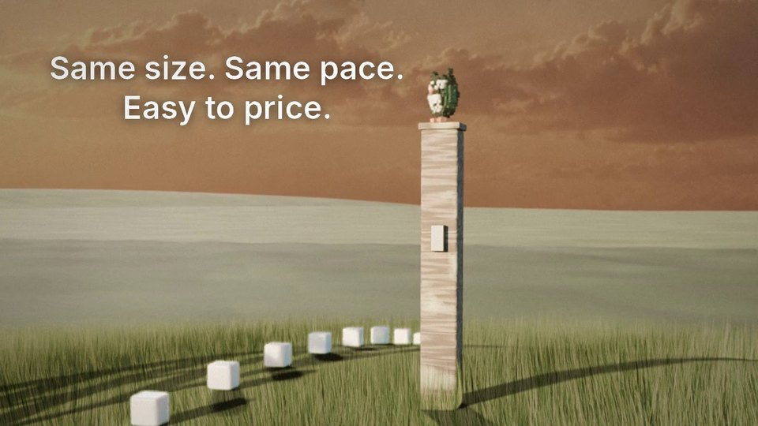
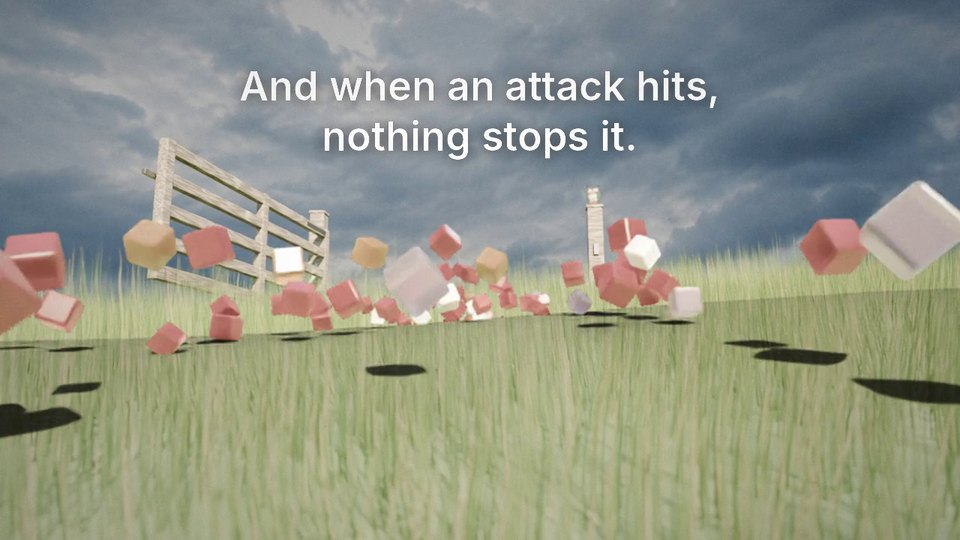
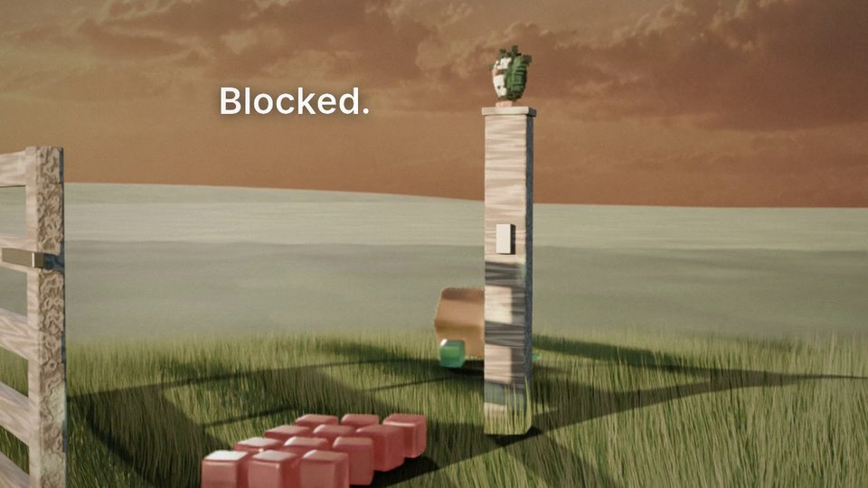
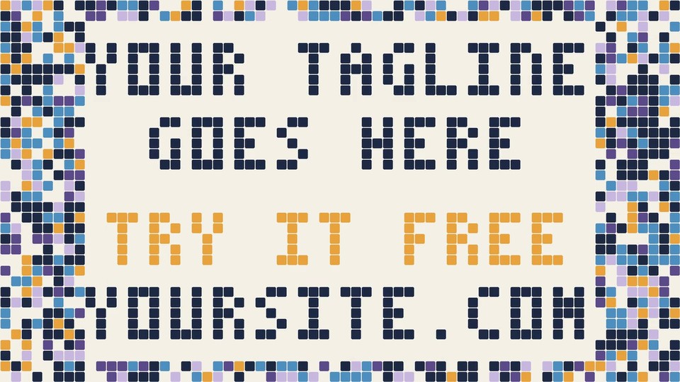

# blender-product-video

A Claude skill for making a silent, text-led product film from code: a photoreal Blender set, a
small character, and a 2D block-grid ending that flips to spell your headline and call to action.
No GUI, no GPU required.



| | | |
| --- | --- | --- |
|  |  |  |

## What it does

- Walks through the film in order: brief, metaphor, beat sheet, character options, set, animation,
  render, composite, review.
- Builds the whole set in Python with Blender's `bpy` module: a hill with hair-particle grass, a
  wooden gate, frosted blocks, sky plates, aerial haze.
- Renders in two passes so it finishes on a CPU: one photoreal still per shot, plus cheap
  transparent layers for everything that moves.
- Composites with numpy, Pillow and ffmpeg: 2D camera moves, text overlays, grade, grain, and an
  ending drawn as a 64x36 grid of blocks.
- Keeps your copy and colors in one file, `film.json`.

The included example film, "The Gate", shows a steady stream of blocks turning unpredictable and
then being brought under control by a gate. Swap the metaphor for your own product.

## Use it as a skill

The skill is [SKILL.md](SKILL.md) plus the scripts it drives.

- **Claude app:** download [dist/blender-product-video.zip](dist/blender-product-video.zip) and upload
  it under Settings, Capabilities, Skills.
- **Claude Code:** clone this repo into `~/.claude/skills/blender-product-video/`.

Then ask for something like "make a launch video for my product with the blender-product-video
skill".

## Use it by hand

```
python -m venv venv && . venv/bin/activate
pip install bpy==5.3.0 numpy pillow        # ffmpeg must also be on your PATH

# quick check: low resolution, one frame per shot
TEST=1 python scripts/blender/film.py plates
TEST=1 python scripts/blender/film.py layers
python scripts/post/comp.py draft.mp4 --draft

# full render of the example (hours on a CPU)
python scripts/blender/film.py plates
python scripts/blender/film.py layers
python scripts/post/comp.py film.mp4
```

Edit `film.json` to change the palette, the overlay lines and their timings, and the four lines the
ending spells (12 characters per line at most).

## Layout

```
SKILL.md                   the method, the pitfalls, the limits
film.json                  palette, overlay text, ending lines
scripts/blender/build.py   set, materials, sky, render settings
scripts/blender/mascot.py  example voxel owl
scripts/blender/film.py    shots, cameras, animation, the two render passes
scripts/post/comp.py       compositor and 2D ending
assets/                    sky plates
examples/                  frames from a finished film
```

## Honest limits

The example settings were chosen to finish on a CPU, and it shows: 720p, locked-off 3D cameras
with 2D moves on top, 12 fps motion on the moving layers, no motion blur, no sound. SKILL.md lists
what to raise when you have a GPU.

Checked on Blender 5.3 (`bpy` wheel) on Linux: the low-resolution test path above runs end to end.
macOS and Windows haven't been tried.

## License

See [LICENSE](LICENSE).
